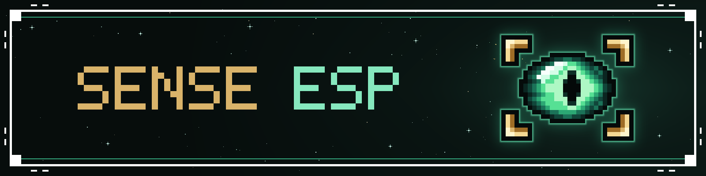
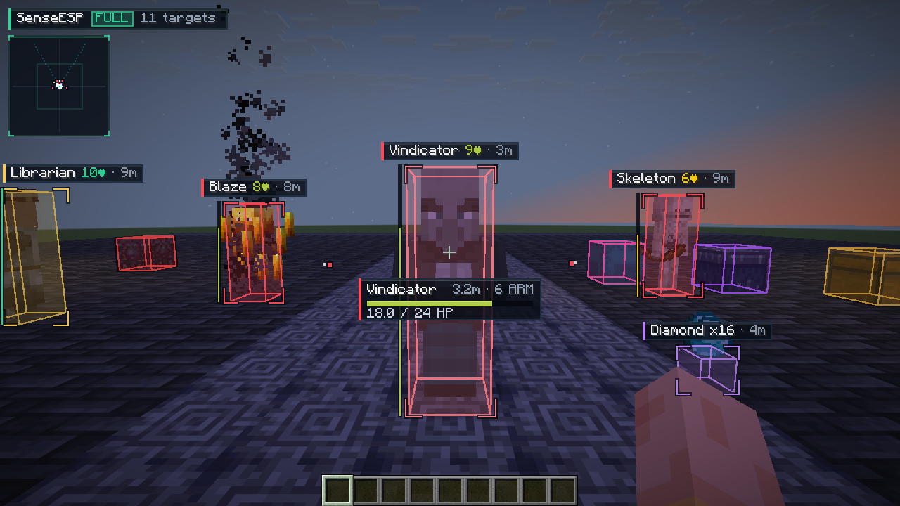
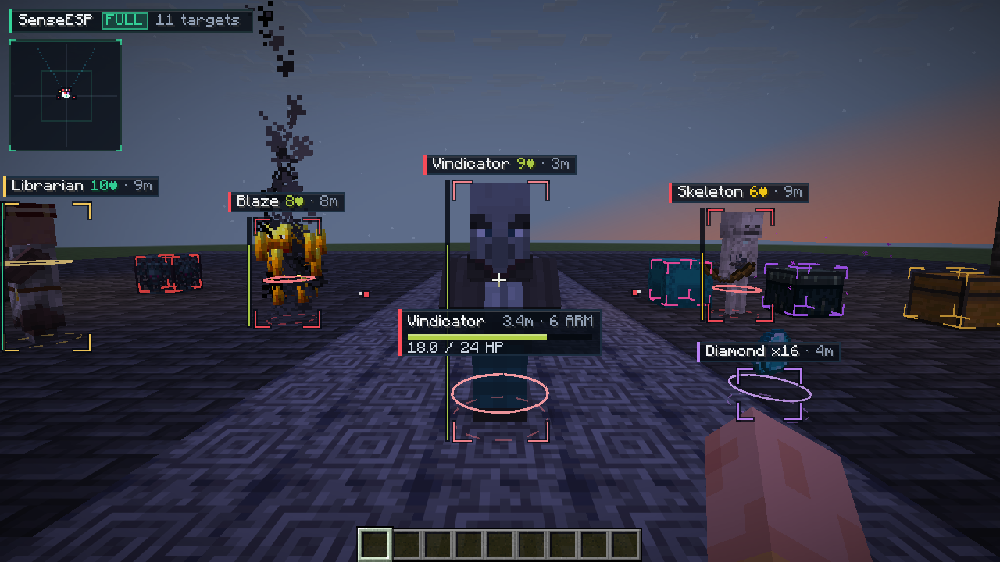
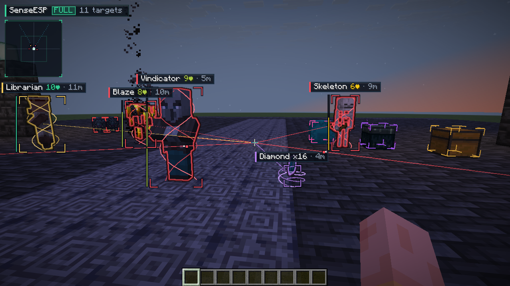
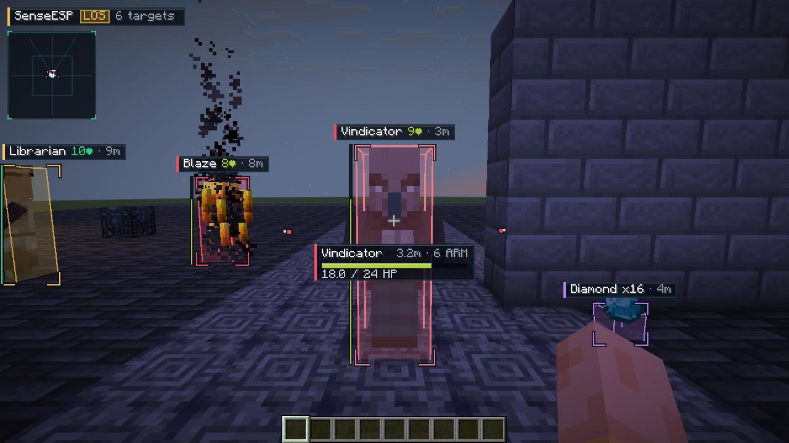
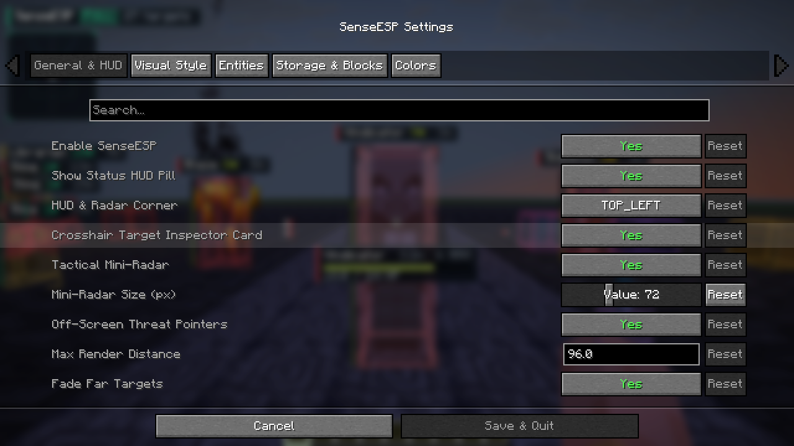

# SenseESP



Client-side tactical HUD, mini-radar, and 3D/2D entity highlight overlay for Fabric (`1.21` – `26.3`).

SenseESP adds a crosshair Target HUD card, a live corner mini-radar, off-screen direction pointers, and five 3D highlight styles (`Filled`, `Corners`, `Wireframe`, `Pulse Ring`, `Spiral`) alongside 2D screen brackets and nametag cards. Every visual element can be toggled or tuned in-game via Cloth Config or Mod Menu.



## Multiplayer & Fair Play

SenseESP checks session permissions automatically:

- **Singleplayer & Server Operators (OP level 2+):** Full 3D/2D rendering, entity outlines, and storage/spawner highlights are enabled for world inspection, debugging, and map-making.
- **Standard Multiplayer (non-OP):** Rendering is restricted to visible, non-invisible entities with direct line-of-sight (`COLLIDER` raycast) and depth testing enabled. Storage highlights and glowing outlines stay disabled automatically.

| Pulse Ring 3D Style | Spiral, Outlines & Tracers |
| :---: | :---: |
|  |  |

| Fair-Play LOS Mode (Non-OP) | In-Game Cloth Config |
| :---: | :---: |
|  |  |

## Features

- **5 3D Highlight Styles:** Translucent `Filled` box, `Corners`, `Wireframe`, animated vertical `Pulse Ring`, and rotating double-helix `Spiral`.
- **Crosshair Target HUD:** Glass inspector card below the crosshair showing the looked-at entity's name, distance, armor points, absorption, and a smoothly animated health bar.
- **Tactical Mini-Radar:** Resizable corner radar (`48`–`120 px`) displaying FOV cone, range grid, and color-coded blips for tracked entities within valid visibility rules.
- **Off-Screen Direction Pointers:** Subtle directional markers around the crosshair ring pointing toward nearby tracked entities outside the camera view.
- **Hit-Flash & Lock-On Feedback:** Targets flash crimson when taking damage (`hurtTime`) and brighten when locked under the crosshair.
- **2D Brackets & Info Cards:** Projected 2D corner or full boxes, smooth vertical HP + absorption bars, and compact cards with stack counts for dropped items.
- **Status HUD Pill:** Shows active state, permission mode (`FULL` or `LOS`), and tracked target count in any screen corner.
- **Storage & Block Highlights (SP / OP only):** Chests, barrels, hoppers, ender chests, shulker boxes, mob spawners, trial spawners, and vaults.
- **Localization:** English (`en_us`) and Russian (`ru_ru`).

## Default Keybinds

| Action | Default Key |
| :--- | :--- |
| Toggle SenseESP | `K` |
| Open Config Screen | `O` |
| Toggle Status & Radar HUD | `U` |

All keybinds can be rebound in **Options -> Controls -> Key Binds -> SenseESP**.

## Requirements

- **Fabric Loader** `0.16.0+` (`0.20.1+` recommended for `26.x`)
- **Fabric API** (required)
- **Cloth Config** (required)
- **Mod Menu** (optional)
- **Java 21** for Minecraft `1.21` – `1.21.11`, **Java 25** for Minecraft `26.1` – `26.3`

## Building

Gradle runs on **JDK 25** (required by Fabric Loom `1.19+`) and cross-compiles `1.21.x` subprojects with `--release 21`.

```bash
# Build a single target (for example 26.3 or 1.21.11)
./gradlew -Ptarget=v26_3 :v26_3:build
./gradlew -Ptarget=v1_21_11 :v1_21_11:build

# Regenerate procedural pixel-art branding (icon & banner)
python3 scripts/draw_branding.py
```

## License

MIT License — Copyright (c) Sooqwess.
