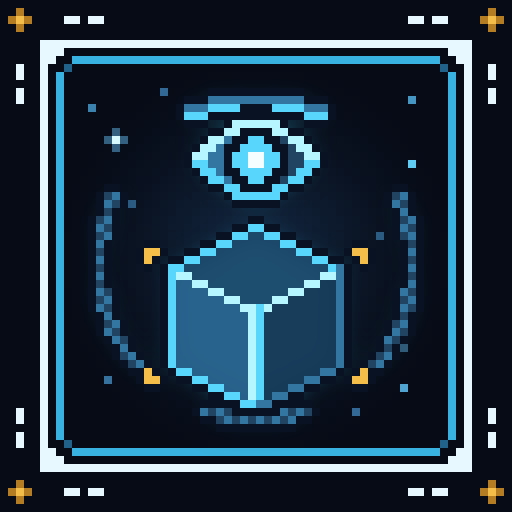

# SenseESP



Client-side entity and block highlight overlay for Fabric (`1.21` – `26.3`).

SenseESP draws configurable 3D bounding boxes, 2D screen brackets, health bars, compact info cards, and optional tracer lines around nearby targets. All settings can be changed in-game with Cloth Config or Mod Menu.

## Multiplayer & Fair Play

SenseESP checks session permissions automatically:

- **Singleplayer & Server Operators (OP level 2+):** Full 3D/2D rendering, entity outlines, and container/spawner highlights are available for admin inspection, debugging, and map-making.
- **Standard Multiplayer (non-OP):** Rendering is restricted to visible, non-invisible entities with direct line-of-sight (`COLLIDER` raycast) and depth testing enabled. Storage highlights and glowing outlines are disabled automatically.

## Features

- **3D Box Styles:** Wireframe, corner-only brackets, or translucent filled boxes with adjustable line width and fill opacity.
- **2D HUD Overlay:** Projected 2D corner or full brackets, vertical health bar next to living targets, and bordered info cards showing name, stack count, hearts, and distance.
- **Status HUD Pill:** Compact HUD indicator showing active state, current permission mode (`FULL` or `LOS`), and tracked target count. Positionable in any screen corner.
- **Entity Filters:** Players, hostile mobs, passive/neutral mobs, villagers & tamed pets, dropped items (with stack size), and boats/minecarts.
- **Storage & Block Highlights (SP / OP only):** Chests, barrels, hoppers, ender chests, shulker boxes, mob spawners, trial spawners, and vaults.
- **Per-Category Colors & Distance Fade:** Separate RGB pickers for every entity and block group, plus smooth alpha fade near max distance.
- **Localization:** English (`en_us`) and Russian (`ru_ru`).

## Default Keybinds

| Action | Default Key |
| :--- | :--- |
| Toggle SenseESP | `K` |
| Open Config Screen | `O` |
| Toggle Status HUD Pill | `U` |

All keybinds can be rebound in **Options -> Controls -> Key Binds -> SenseESP**.

## Requirements

- **Fabric Loader** `0.16.0+` (`0.20.1+` recommended for `26.x`)
- **Fabric API** (required)
- **Cloth Config** (required)
- **Mod Menu** (optional)
- **Java 21** for Minecraft `1.21` – `1.21.11`, **Java 25** for Minecraft `26.1` – `26.3`

## Building

 Gradle runs on **JDK 25** (required by Fabric Loom `1.19+`) and cross-compiles `1.21.x` subprojects with `--release 21`.

```bash
# Build a single target (for example 26.3 or 1.21.11)
./gradlew -Ptarget=v26_3 :v26_3:build
./gradlew -Ptarget=v1_21_11 :v1_21_11:build
```

## License

MIT License — Copyright (c) Sooqwess.
